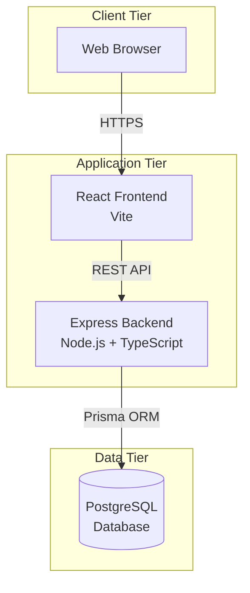

# StokFlow — System Architecture

**Version:** 1.0.0  
**Last Updated:** October 24, 2026  
**Status:** Phase 0 — Foundation Baseline

---

## 1. System Context

StokFlow is a client-specific web application for inventory and sales management. It consists of:
- A React frontend (SPA) served via Vite
- An Express backend API
- A PostgreSQL relational database

The system is deployed as a **modular monolith**, not a microservices architecture.

**Deployment Model:** Single-tenant deployment for one client organization.

---

## 2. High-Level Architecture



---

## 3. Component Boundaries and Responsibilities

### 3.1 Frontend (React + Vite)

**Location:** `apps/web/`

**Responsibilities:**
- Render user interface
- Handle user interactions and form state
- Client-side navigation and routing
- Call backend API endpoints
- Display validation errors and operation status
- Provide responsive and accessible UI

**NOT Responsible For:**
- Authentication (only initiates login, backend validates)
- Authorization enforcement (only hides UI for UX, backend enforces)
- Business rule validation (backend is authoritative)
- Direct database access
- Storing sensitive secrets

**Technology:**
- React 18+
- TypeScript
- Vite (build tool and dev server)
- React Router (routing)
- TBD: UI component library (if any)
- TBD: State management (if needed beyond React state)

**Environment Variables:**
- `VITE_API_BASE_URL`: Backend API base URL (exposed to browser)
- NEVER include database credentials or server secrets

**Build Output:** Static files served by a web server or CDN

---

### 3.2 Backend (Express + TypeScript)

**Location:** `apps/server/`

**Responsibilities:**
- Authentication (validate credentials, manage sessions/tokens)
- Authorization (enforce role-based access control)
- Input validation (validate all incoming requests)
- Business logic (enforce all business rules)
- Data persistence (via Prisma ORM)
- Transaction management (atomic operations)
- Audit logging
- Error handling and safe error responses
- Rate limiting
- API responses in consistent format

**Technology:**
- Node.js 22.x or 24.x LTS
- Express
- TypeScript
- Prisma ORM
- Argon2id for password hashing (node-argon2 package)
- TBD: express-session or alternative for session management
- TBD: express-validator or zod for request validation
- TBD: winston or pino for structured logging
- TBD: express-rate-limit for rate limiting

**Environment Variables:**
- `DATABASE_URL`: PostgreSQL connection string
- `SESSION_SECRET`: Secret for session signing
- `NODE_ENV`: development | production
- `PORT`: Server port
- `CORS_ORIGIN`: Allowed frontend origin(s)
- All secrets loaded from `.env`, never committed to Git

**Module Structure:**

```
apps/server/src/
├── app.ts                  # Express app configuration
├── server.ts               # Server startup
├── config/                 # Environment and configuration validation
├── routes/                 # API route definitions
├── middleware/             # Authentication, authorization, validation, error handling
├── modules/                # Domain-specific business logic
│   ├── auth/
│   ├── users/
│   ├── products/
│   ├── inventory/
│   ├── customers/
│   ├── sales/
│   ├── payments/
│   ├── receivables/  # If in scope
│   ├── reports/
│   └── audit/
├── lib/                    # Shared utilities (logger, database helpers)
└── types/                  # Shared TypeScript types
```

**Domain Module Structure (Example: `products`):**

```
modules/products/
├── products.routes.ts      # Route definitions
├── products.controller.ts  # Request handling, response formatting
├── products.service.ts     # Business logic
├── products.repository.ts  # Database queries (if repository pattern used)
├── products.validation.ts  # Request validation schemas
└── products.types.ts       # Module-specific types
```

**Layering:**
- **Routes:** Register endpoints, apply middleware
- **Controllers:** Parse requests, call services, format responses
- **Services:** Implement business logic, coordinate repositories, enforce rules
- **Repositories:** Execute database queries (optional layer; can use Prisma Client directly in services for simple cases)

---

### 3.3 Database (PostgreSQL + Prisma)

**Location:** `apps/server/prisma/`

**Responsibilities:**
- Persistent data storage
- Enforce relational integrity (foreign keys, unique constraints)
- Provide transactional guarantees
- Indexing for query performance

**Technology:**
- PostgreSQL 15+ or 16+
- Prisma ORM for schema definition, migrations, and type-safe queries

**Schema Management:**
- `schema.prisma`: Declarative database schema
- `migrations/`: Version-controlled migration files
- Migrations applied via `prisma migrate deploy` in production

**Prisma Configuration:**
- Use `Decimal` type for monetary amounts (NUMERIC in PostgreSQL)
- Use `Int` or `Decimal` for quantities based on business requirements
- Enforce foreign key constraints
- Define unique constraints (e.g., SKU, category name)
- Use `@@index` for frequently queried fields
- Use `createdAt` and `updatedAt` timestamps where appropriate

**Database Design Principles:**
- Normalize to 3NF where appropriate
- Denormalize only when justified for performance with clear tradeoffs
- Use surrogate integer primary keys (auto-increment) for most tables
- Capture price and cost snapshots in transactional tables (sale line items)
- Capture inventory movement history with immutable records
- Use database constraints to enforce data integrity
- Avoid cascading deletes for sensitive financial records; use soft deletes or status flags if needed

---

## 4. Request Flow

### 4.1 Typical API Request Flow

```
1. Browser sends HTTP request to Express API
2. Express middleware chain:
   a. CORS middleware (validate origin)
   b. Body parser middleware (parse JSON)
   c. Rate limiter middleware (check rate limits)
   d. Request correlation middleware (assign request ID)
   e. Authentication middleware (validate session/token)
   f. Route-specific validation middleware (validate request schema)
   g. Authorization middleware (check user role and permissions)
3. Controller receives validated request
4. Controller calls service with parsed data
5. Service enforces business rules
6. Service uses Prisma Client to query/mutate database
7. Prisma Client executes SQL against PostgreSQL
8. PostgreSQL returns data
9. Service returns result to controller
10. Controller formats response (success or error)
11. Express error handler catches any exceptions
12. Response sent to browser
```

**Authentication Flow:**
1. User submits login credentials (email, password)
2. Backend validates credentials against hashed password
3. On success, backend creates session or token
4. Session ID stored in HttpOnly, Secure cookie (if session-based)
5. Subsequent requests include session cookie
6. Authentication middleware validates session on each request

**Authorization Flow:**
1. After authentication, middleware extracts user role
2. Authorization middleware checks if user role permits the action
3. For resource-specific checks (e.g., IDOR prevention), service layer validates ownership or access rights
4. Unauthorized requests return 403 Forbidden

---

## 5. API Design Conventions

### 5.1 Base URL

`/api/v1`

Versioned API allows future changes without breaking existing clients.

### 5.2 Endpoint Naming

RESTful resource-oriented naming:
- `GET /api/v1/products` — List products
- `GET /api/v1/products/:id` — Get single product
- `POST /api/v1/products` — Create product
- `PUT /api/v1/products/:id` — Update product
- `DELETE /api/v1/products/:id` — Delete product (if allowed)

Nested resources:
- `GET /api/v1/sales/:id/payments` — List payments for a sale
- `POST /api/v1/sales/:id/payments` — Record payment for a sale

### 5.3 Request Validation

- All request bodies validated against schemas (e.g., express-validator or zod)
- Validation errors return 400 Bad Request with structured error details
- Never trust client-provided data

### 5.4 Response Format

**Success Response (200, 201):**
```json
{
  "success": true,
  "data": { ... }
}
```

**Error Response (4xx, 5xx):**
```json
{
  "success": false,
  "error": {
    "code": "VALIDATION_ERROR",
    "message": "Validation failed",
    "details": [
      { "field": "sku", "message": "SKU is required" }
    ]
  }
}
```

**Pagination (for list endpoints):**
```json
{
  "success": true,
  "data": [ ... ],
  "pagination": {
    "page": 1,
    "pageSize": 20,
    "totalCount": 150,
    "totalPages": 8
  }
}
```

### 5.5 HTTP Status Codes

- `200 OK` — Successful GET, PUT, PATCH
- `201 Created` — Successful POST with resource creation
- `204 No Content` — Successful DELETE
- `400 Bad Request` — Validation error or malformed request
- `401 Unauthorized` — Authentication required or failed
- `403 Forbidden` — Authenticated but not authorized
- `404 Not Found` — Resource not found
- `409 Conflict` — Duplicate resource or constraint violation
- `429 Too Many Requests` — Rate limit exceeded
- `500 Internal Server Error` — Unexpected server error (logged, not detailed to client)

---

## 6. Security Architecture

### 6.1 Authentication

**Mechanism:** Server-managed sessions (recommended) or JWT tokens

**Session-Based (Recommended):**
- Sessions stored server-side (in-memory or Redis for production scalability)
- Session ID stored in HttpOnly, Secure, SameSite=Strict cookie
- Session expires after inactivity (e.g., 24 hours)
- Logout invalidates session server-side

**Password Security:**
- Passwords hashed with Argon2id
- Password policy: minimum length, complexity (TBD based on client requirements)
- Failed login attempts rate-limited per IP and per email
- Password reset (if implemented) uses secure tokens

**CSRF Protection:**
- If session-based: use CSRF tokens for state-changing requests
- If token-based: tokens stored securely, not in localStorage

### 6.2 Authorization

**Enforcement:**
- Every protected endpoint checks authentication first
- Authorization middleware or service-layer checks verify user role
- For resource-specific actions (e.g., viewing a specific sale), verify user has access to that resource (prevent IDOR)

**Role Hierarchy (Proposed):**
- Admin > Manager > Cashier > Viewer
- Roles defined in database, associated with users

**Principle of Least Privilege:**
- Users assigned only the permissions necessary for their role
- Default deny: unless explicitly permitted, action is forbidden

### 6.3 Input Validation and Output Encoding

**Input Validation:**
- All request inputs validated against schemas
- Type checking, length limits, format validation
- SQL injection prevented by Prisma's parameterized queries
- No raw SQL unless absolutely necessary and carefully reviewed

**Output Encoding:**
- React escapes output by default (prevents XSS)
- API responses are JSON (Content-Type: application/json)
- Avoid rendering unsanitized HTML

### 6.4 CORS and HTTP Headers

**CORS:**
- Explicit origin allowlist (no wildcard in production)
- Configured via Express cors middleware
- Development: allow frontend dev server origin
- Production: allow production frontend origin only

**Security Headers:**
- `Content-Security-Policy` (strict policy)
- `X-Content-Type-Options: nosniff`
- `X-Frame-Options: DENY` or `SAMEORIGIN`
- `Strict-Transport-Security` (HSTS) in production
- `X-XSS-Protection: 1; mode=block` (legacy browsers)

### 6.5 Rate Limiting

- Login endpoint: strict rate limit (e.g., 5 attempts per 15 minutes per IP)
- General API: rate limit per user or IP (e.g., 100 requests per 15 minutes)
- Prevents brute-force attacks and abuse

### 6.6 Secrets Management

- All secrets in environment variables, never in code
- `.env` file for local development, gitignored
- Production secrets managed by deployment platform or secret manager
- Database credentials, session secrets, API keys never committed to Git

### 6.7 Logging and Monitoring

**Logging:**
- Structured logs (JSON format)
- Request correlation IDs for tracing
- Log levels: error, warn, info, debug
- Sensitive data (passwords, tokens, PII) never logged

**Audit Logging:**
- Separate audit log table in database
- Records: user, action, resource, timestamp, IP address
- Immutable: no updates or deletes
- Logged actions: authentication, authorization failures, stock adjustments, sales, payments, user management

**Monitoring:**
- Application logs monitored for errors
- Database performance monitored for slow queries
- Incident response procedures documented (Phase 0: documentation only)

---

## 7. Data Integrity and Transactions

### 7.1 Transactional Operations

**Atomic Sales:**
- Sale creation and stock deduction must occur in a single database transaction
- If any line item cannot be fulfilled, entire sale is rolled back
- Use Prisma `$transaction` API

**Example (conceptual):**
```typescript
await prisma.$transaction(async (tx) => {
  // Create sale record
  const sale = await tx.sale.create({ ... });
  
  // Create sale line items
  for (const item of lineItems) {
    await tx.saleLineItem.create({ ... });
  }
  
  // Deduct stock for each product
  for (const item of lineItems) {
    await tx.product.update({
      where: { id: item.productId },
      data: { stock: { decrement: item.quantity } }
    });
    
    // Record inventory movement
    await tx.inventoryMovement.create({ ... });
  }
});
```

**Concurrency:**
- For concurrent stock updates, use optimistic locking or database-level row locking
- Consider: `SELECT ... FOR UPDATE` if race conditions are likely
- Alternatively, use database constraints to prevent negative stock

### 7.2 Data Precision

**Monetary Amounts:**
- Use `Decimal` type (PostgreSQL NUMERIC) for prices, totals, payments
- Never use floating-point for money
- Store values in smallest unit if applicable (e.g., cents), or use sufficient decimal places

**Quantities:**
- Use `Int` for whole-unit quantities
- Use `Decimal` if fractional quantities are needed (e.g., 1.5 kg)

### 7.3 Immutability and Audit Trails

**Inventory Movements:**
- Immutable: once created, never updated or deleted
- Corrections made through reversal or adjustment movements

**Sales and Payments:**
- Sales should not be silently deleted; use "Cancelled" status if cancellation is needed
- Payments should not be deleted; use reversals or refunds if needed
- Preserve complete history for audit and reconciliation

**Audit Logs:**
- Immutable: never updated or deleted
- Tamper-evident: consider including checksums or hashes if advanced auditability required

---

## 8. Error Handling

### 8.1 Backend Error Handling

**Principles:**
- Never expose internal error details (stack traces, database errors) to clients
- Log detailed errors server-side with request correlation IDs
- Return safe, actionable error messages to clients

**Error Categories:**
- **Validation Errors:** 400 with field-level details
- **Authentication Errors:** 401 with generic message ("Invalid credentials")
- **Authorization Errors:** 403 with generic message ("Forbidden")
- **Not Found Errors:** 404 with safe message
- **Conflict Errors:** 409 with explanation (e.g., "SKU already exists")
- **Rate Limit Errors:** 429 with retry-after header
- **Server Errors:** 500 with generic message, log full details

**Express Error Handler:**
- Centralized error handler middleware at the end of middleware chain
- Catches all unhandled errors
- Logs errors with correlation ID
- Returns consistent error response format

### 8.2 Frontend Error Handling

- Display user-friendly error messages from API responses
- Provide actionable guidance (e.g., "Please check SKU field")
- Avoid technical jargon in user-facing messages
- Log client-side errors for debugging (if monitoring tool integrated)

---

## 9. Testing Architecture

### 9.1 Testing Layers

**Unit Tests:**
- Test business logic in services
- Test utility functions
- Mock external dependencies (database, API calls)
- Fast, isolated, no I/O

**Integration Tests:**
- Test API endpoints end-to-end
- Use test database (separate from development database)
- Test database interactions via Prisma
- Test authentication and authorization
- Test transactional integrity

**End-to-End Tests:**
- Test critical user journeys through the browser
- Use Playwright or similar
- Test frontend + backend + database integration
- Run against staging or test environment

**Security Tests:**
- Test unauthorized access attempts
- Test privilege escalation scenarios
- Test input validation bypass attempts
- Test IDOR vulnerabilities
- Test concurrent operations and race conditions

### 9.2 Testing Tools

- **Unit + Integration:** Vitest (fast, TypeScript-native, Vite-compatible)
- **API Testing:** Supertest (HTTP assertions)
- **E2E Testing:** Playwright (browser automation)
- **Test Database:** PostgreSQL test instance or Docker container

### 9.3 Test Database Strategy

- Use separate test database (e.g., `stokflow_test`)
- Reset database state before each test (truncate tables or re-run migrations)
- Seed test data as needed
- Never run tests against production database

### 9.4 Continuous Integration

- GitHub Actions or similar CI pipeline
- Run lint, type-check, unit tests, integration tests on every commit
- Block merges if tests fail
- Run E2E tests before production deployment

---

## 10. Deployment Architecture

### 10.1 Deployment Model (Conceptual)

**Frontend:**
- Build static assets: `npm run build` (Vite)
- Deploy to static file server, CDN, or platform (e.g., Netlify, Vercel, S3 + CloudFront)
- Serve over HTTPS

**Backend:**
- Build TypeScript: `npm run build` (tsc)
- Deploy Node.js application to server or platform (e.g., Heroku, Railway, AWS EC2, DigitalOcean)
- Run with process manager (e.g., PM2) for stability
- Serve over HTTPS (via reverse proxy like Nginx or platform's built-in SSL)

**Database:**
- Managed PostgreSQL service (e.g., AWS RDS, Heroku Postgres, DigitalOcean Managed Databases)
- Or self-hosted PostgreSQL with backup procedures

**Environment Variables:**
- Set securely in deployment platform
- Never commit to Git

**Database Migrations:**
- Run `prisma migrate deploy` as part of deployment process
- Review migrations before applying to production

### 10.2 Backup and Recovery

**Backup Strategy:**
- Regular automated database backups (frequency TBD based on client requirements)
- Store backups securely with encryption
- Retention policy defined and documented

**Recovery Procedures:**
- Document step-by-step restoration process
- Test restoration periodically
- Maintain backup access credentials securely

**Responsibilities:**
- Clarify whether development team or client operations team manages backups

---

## 11. Architecture Decisions

### AD-001: Modular Monolith vs. Microservices

**Decision:** Use a modular monolith (single backend application with clear module boundaries).

**Rationale:**
- Simpler deployment and operations
- Lower complexity for single-client application
- Easier to maintain transactional integrity
- Faster development with shared database
- No premature over-engineering

**Consequences:**
- Single deployment unit
- Must maintain clear module boundaries to avoid coupling
- Scaling requires horizontal scaling of entire application

**Status:** Accepted

---

### AD-002: Session-Based vs. Token-Based Authentication

**Decision:** Deferred pending implementation (Phase 2).

**Options:**
1. **Session-Based (cookies + server-side sessions):**
   - Pros: Easier CSRF protection, easier to revoke sessions, no token expiry complexity
   - Cons: Requires session store for horizontal scaling (e.g., Redis)

2. **Token-Based (JWT):**
   - Pros: Stateless, easier to scale horizontally
   - Cons: Harder to revoke tokens, must handle token refresh, risk of token theft if stored in localStorage

**Recommendation:** Start with session-based for simplicity unless client requirements favor tokens.

**Status:** Open

---

### AD-003: Repository Pattern vs. Direct Prisma Usage

**Decision:** Deferred pending implementation.

**Options:**
1. **Repository Pattern:**
   - Pros: Abstracts database layer, easier to test, clearer separation
   - Cons: Additional boilerplate, may be overkill for simple CRUD

2. **Direct Prisma Client in Services:**
   - Pros: Less boilerplate, Prisma already provides abstraction
   - Cons: Services tightly coupled to Prisma

**Recommendation:** Start with direct Prisma usage; introduce repository pattern only if needed for complex queries or testing.

**Status:** Open

---

### AD-004: Shared Package for Frontend-Backend Types

**Decision:** Deferred pending implementation.

**Options:**
1. **Create `packages/shared/` with common types:**
   - Pros: Single source of truth for API contracts
   - Cons: Adds build complexity, must avoid leaking backend-only types to frontend

2. **Duplicate types or generate from OpenAPI schema:**
   - Pros: Simpler build, clear separation
   - Cons: Risk of drift between frontend and backend

**Recommendation:** Start without shared package; introduce if type drift becomes a problem.

**Status:** Open

---

### AD-005: Database Constraint vs. Application-Level Stock Validation

**Decision:** Use both application-level checks and database constraints.

**Rationale:**
- Application checks provide user-friendly error messages
- Database constraints provide ultimate safety net against race conditions and bugs

**Implementation:**
- Application: validate stock availability before sale confirmation
- Database: use CHECK constraint `stock >= 0` (if negative stock should be prevented)

**Status:** Accepted (with caveat: client must confirm negative stock policy)

---

## 12. Open Architectural Decisions

### OAD-001: Negative Stock Prevention
- **Question:** Should the database enforce stock >= 0, or allow negative stock with application warnings?
- **Impact:** Database schema design, business logic
- **Status:** Pending client confirmation

### OAD-002: Multi-Organization Support
- **Question:** Will the client ever need to manage multiple separate organizations (true multi-tenancy)?
- **Impact:** Database schema (tenant isolation), authorization model
- **Status:** Pending client confirmation (current assumption: single organization)

### OAD-003: Soft Deletes vs. Hard Deletes
- **Question:** Should sensitive records (sales, payments) be soft-deleted (marked inactive) or hard-deleted?
- **Impact:** Database schema, queries, audit integrity
- **Recommendation:** Soft delete or status change for financial records
- **Status:** Open

### OAD-004: Caching Strategy
- **Question:** Is caching needed for performance (e.g., Redis for frequently accessed data)?
- **Impact:** Architecture complexity, infrastructure requirements
- **Recommendation:** Start without caching; introduce only if performance requires it
- **Status:** Open

---

## 13. Technology Stack Summary

| Layer | Technology | Justification |
|-------|------------|---------------|
| **Runtime** | Node.js 22.x or 24.x LTS | Long-term support, active maintenance, security updates |
| **Backend Framework** | Express | Mature, widely adopted, flexible, middleware ecosystem |
| **Frontend Framework** | React 18+ | Modern, component-based, strong ecosystem, TypeScript support |
| **Build Tool** | Vite | Fast dev server, optimized production builds, Vite is the current standard for React |
| **Language** | TypeScript | Type safety, maintainability, tooling support |
| **Database** | PostgreSQL 15+/16+ | ACID compliance, relational integrity, mature, excellent Prisma support |
| **ORM** | Prisma | Type-safe queries, migration management, active development |
| **Password Hashing** | Argon2id (node-argon2) | OWASP-recommended, memory-hard, resistant to GPU/ASIC attacks |
| **Testing** | Vitest | Fast, TypeScript-native, excellent Vite integration |
| **E2E Testing** | Playwright | Cross-browser, reliable, modern API |
| **Package Manager** | npm | Native Node.js package manager, workspace support |

**Additional Dependencies (TBD during implementation):**
- Request validation: express-validator or zod
- Logging: winston or pino
- Rate limiting: express-rate-limit
- Session management: express-session (if session-based auth)
- CORS: cors
- Security headers: helmet

---

## 14. Non-Goals and Constraints

### Non-Goals
- Microservices architecture
- Multi-tenant SaaS infrastructure
- Real-time collaborative features
- Mobile native applications
- Third-party integrations (unless confirmed in scope)

### Constraints
- Must run on Node.js LTS
- Must use PostgreSQL (no NoSQL)
- Must be deployable as a standard web application
- Must support modern browsers only (no IE11)
- Must follow security-first principles
- Must maintain audit trails for financial data

---

## 15. Revision History

| Version | Date | Author | Changes |
|---------|------|--------|---------|
| 1.0.0 | 2026-10-24 | StokFlow Team | Initial architecture baseline for Phase 0 |

---

**END OF ARCHITECTURE DOCUMENT**
